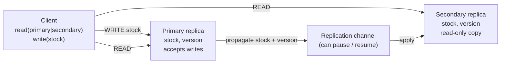
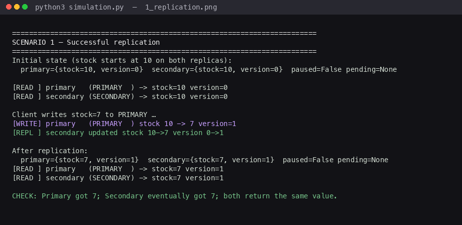
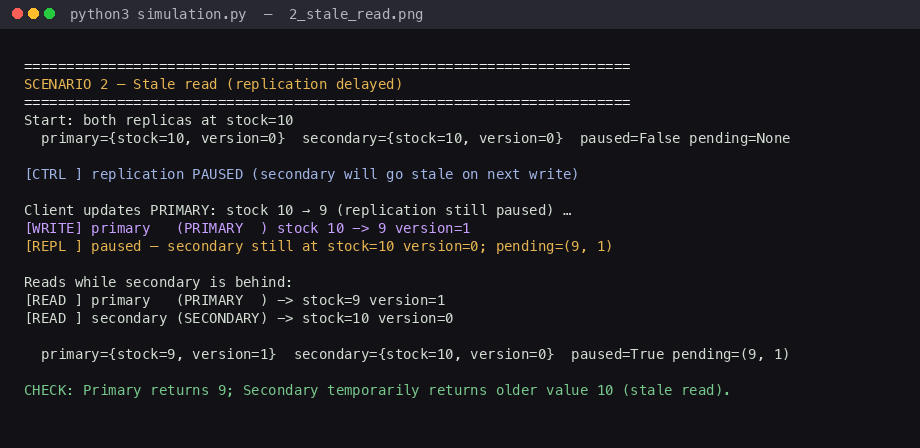
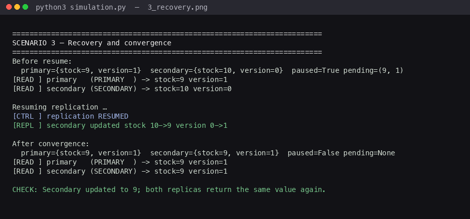
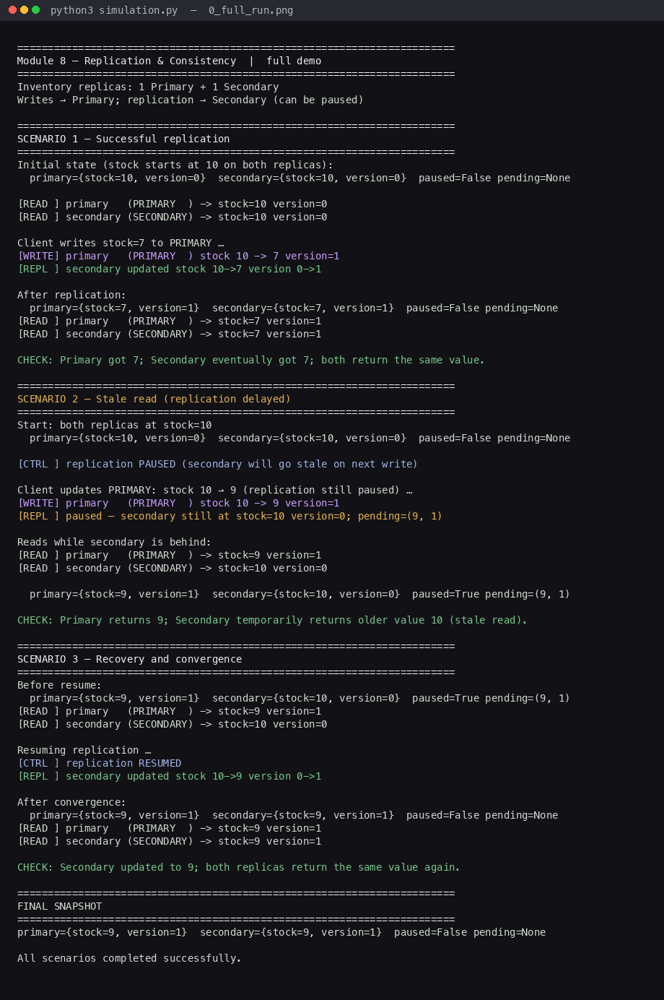

# Module 8 – Replication & Consistency

A small **replicated inventory system** in Python with:

* **1 Primary** replica (accepts writes)
* **1 Secondary** replica (receives replicated state)
* A **client** that can read inventory from either replica

Example starting value:

```
stock = 10
```

Updates are written to the Primary and then propagated to the Secondary. Replication can be **paused** to demonstrate stale reads, then **resumed** so the replicas converge again.

## Repository layout

```
.
├── replica.py               # Primary / Secondary + controllable replication
├── simulation.py            # scenarios: replication, stale read, recovery
├── requirements.txt         # stdlib only (Python 3.10+)
├── scripts/demo.sh          # run all scenarios + refresh evidence/
├── evidence/                # raw terminal logs from the demo run
└── screenshots/             # terminal-style captures of each scenario
```

## Architecture



Plain-text version:

```
                    ┌─────────────────────┐
                    │   Primary replica   │
   write(stock) ───▶│  stock / version    │──┐
   read() ◀─────────│                     │  │  replication
                    └─────────────────────┘  │  (pause → stale reads)
                                             ▼
                    ┌─────────────────────┐
   read() ◀─────────│  Secondary replica  │◀─ apply pending update
                    │  stock / version    │
                    └─────────────────────┘
```

**Rules**

1. Writes always go to the **Primary**.
2. The Secondary is updated only through replication (`stock` + `version`).
3. When replication is **paused**, a write updates Primary immediately but Secondary keeps the old value → **stale read**.
4. When replication **resumes**, the pending update is applied and both replicas **converge**.

---

## How to run

### Prerequisites
* Python 3.10+ (standard library only; no `pip install` needed)

### Run every scenario
```bash
python3 simulation.py --scenario all
```

### Run one scenario
```bash
python3 simulation.py --scenario replication   # write primary → secondary catches up
python3 simulation.py --scenario stale         # pause replication; primary=9, secondary=10
python3 simulation.py --scenario recovery      # resume; both converge to 9
```

### Refresh evidence files
```bash
./scripts/demo.sh
# or:
python3 simulation.py --write-evidence
```

---

## Results and evidence

Screenshots and matching logs are in [`screenshots/`](screenshots/) and [`evidence/`](evidence/).

### 1. Successful replication

Both replicas start at `stock=10`. The client writes `stock=7` to the Primary. Replication runs immediately; Secondary updates `10 → 7`. Both reads then return **7**.



<details>
<summary>Log excerpt (evidence/01_replication.txt)</summary>

```
[READ ] primary   (PRIMARY  ) -> stock=10 version=0
[READ ] secondary (SECONDARY) -> stock=10 version=0

Client writes stock=7 to PRIMARY …
[WRITE] primary   (PRIMARY  ) stock 10 -> 7 version=1
[REPL ] secondary updated stock 10->7 version 0->1

[READ ] primary   (PRIMARY  ) -> stock=7 version=1
[READ ] secondary (SECONDARY) -> stock=7 version=1

CHECK: Primary got 7; Secondary eventually got 7; both return the same value.
```
</details>

### 2. Stale-read test

Replication is paused. Primary is updated from **10 → 9**.

* Primary returns **9**
* Secondary temporarily returns the older value **10**

That is a **stale read** from the Secondary.



<details>
<summary>Log excerpt (evidence/02_stale_read.txt)</summary>

```
[CTRL ] replication PAUSED (secondary will go stale on next write)

Client updates PRIMARY: stock 10 → 9 (replication still paused) …
[WRITE] primary   (PRIMARY  ) stock 10 -> 9 version=1
[REPL ] paused — secondary still at stock=10 version=0; pending=(9, 1)

[READ ] primary   (PRIMARY  ) -> stock=9 version=1
[READ ] secondary (SECONDARY) -> stock=10 version=0

CHECK: Primary returns 9; Secondary temporarily returns older value 10 (stale read).
```
</details>

### 3. Recovery and convergence

Replication is resumed. The pending update is applied to the Secondary (`10 → 9`). Both replicas return **9** again.



<details>
<summary>Log excerpt (evidence/03_recovery.txt)</summary>

```
Before resume:
  primary={stock=9, version=1}  secondary={stock=10, version=0}  paused=True pending=(9, 1)

Resuming replication …
[CTRL ] replication RESUMED
[REPL ] secondary updated stock 10->9 version 0->1

[READ ] primary   (PRIMARY  ) -> stock=9 version=1
[READ ] secondary (SECONDARY) -> stock=9 version=1

CHECK: Secondary updated to 9; both replicas return the same value again.
```
</details>

### Full combined run



Complete log: [`evidence/00_full_run.txt`](evidence/00_full_run.txt).

---

## Reflection

**What tradeoff exists between reading quickly from a replica and guaranteeing that the reader sees the latest value?**

Reading from a nearby Secondary is often faster and spreads load, but that replica may not have received the newest write yet, so the client can see a stale value (as in the 9 vs 10 demo). Guaranteeing the latest value usually means reading from the Primary or waiting for synchronous replication, which adds latency and can reduce availability if the Primary is busy or unreachable. Systems therefore choose between **low-latency / scalable reads** (eventual consistency, possible stale reads) and **stronger freshness** (higher cost per read). Which side you pick depends on whether the application can tolerate temporary staleness.

---

## Design notes

* **Primary** is the only writable replica; Secondary is a read-only copy.
* **Pause / resume** models delayed or interrupted replication without needing real network timing.
* A **pending `(stock, version)`** tuple records the update waiting to be applied while replication is paused.
* After resume, both replicas share the same `stock` and `version` — **convergence**.
